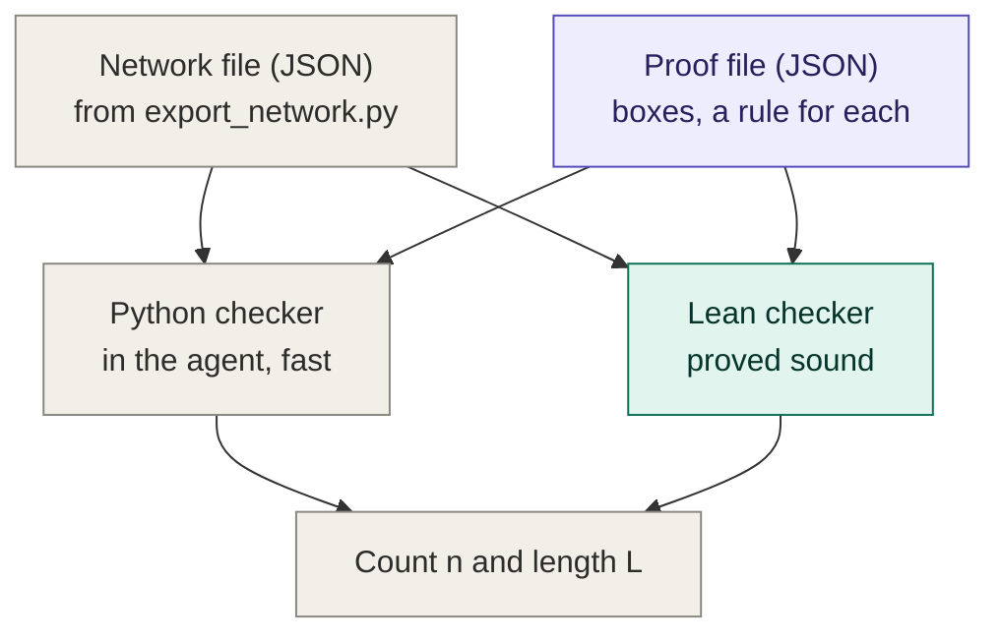
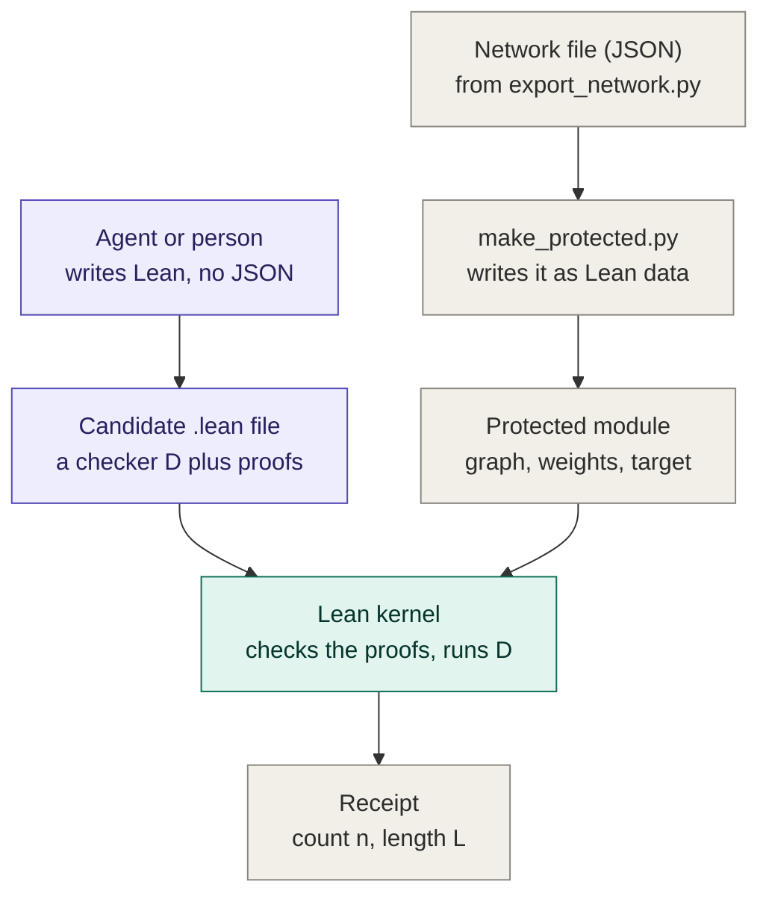

# Compact-Proof-Checker

This repo checks compact proofs about trained neural networks, and it checks them verifiably: when it
accepts a proof, the claim it reports is backed by a theorem that Lean's kernel has checked. You don't have to
trust whoever wrote the proof, or the code that checked it.

What it does:

1. **Input.** A trained network, exported exactly from PyTorch (its graph and its weights), and a proof about
   it. The proof is either a plan in a fixed format (the rules lane) or Lean code (the open lane).
2. **Check.** It rejects the proof with a reason, or accepts it with a certified count $`n`$: a proved lower
   bound on the number of inputs the network answers correctly.
3. **Measure.** It reports the proof's length: how many operations checking the proof costs.

The aim is proofs that certify a lot with little work. Brute force runs the network on every input. A compact
proof uses structure in the network to certify the same inputs with far fewer operations, and that is why
short proofs tend to come with an understanding of how the network computes.

### The formal setting

We follow Gross et al.,
[Compact Proofs of Model Performance via Mechanistic Interpretability](https://arxiv.org/abs/2406.11779)
(2024). A model $`M`$ is evaluated on input-label pairs $`(l, t)`$ drawn from a distribution $`D`$, with a
score $`f(l, M(t))`$, and the quantity of interest is the expected performance

```math
\bar s(M) = \mathbb{E}_{(l,t) \sim D}\, f(l, M(t)).
```

A proof that $`\bar s(M) \ge b`$ is a pair $`(C, Q)`$: a program $`C`$ that takes the model's weights and returns
a number, and an argument $`Q`$ that this number is a lower bound for every model of the same shape,

```math
\forall M' :\ C(M') \le \bar s(M').
```

Running $`C`$ on the actual weights gives the bound $`b = C(M)`$, and the length of the proof is the cost of
that run.

For now we only look at accuracy, as the paper does. $`D`$ is uniform over a finite input set $`X`$, and
$`f`$ is 1 when the label's logit is strictly larger than every other logit and 0 otherwise (ties count as
wrong). Then

```math
\bar s(M) = \frac{\mathrm{numCorrect}(M)}{\lvert X \rvert},
```

where $`\mathrm{numCorrect}(M)`$ is the number of inputs $`M`$ answers correctly. We report a bound as a count
$`n = b \cdot \lvert X \rvert`$, so a proof certifies $`n \le \mathrm{numCorrect}(M)`$.

The Lean library inside is called CompactCheck, and its command-line program `compactcheck`.

## What it works for

The checker never runs PyTorch. `scripts/export_network.py` traces a model of the agent's zoo with
torch.fx and writes a JSON network file: the graph as a list of operations, every weight exactly (a float is
an integer times a power of two, so nothing is rounded), and the task.

```json
{"format": "compactcheck-network-v1", "network": "max2_tiny-v8-s0", "task": "max",
 "graph": {"positions": 2, "values": 8, "nodes": [{"op": "input"}, {"op": "sum", ...}, ...], "output": ...},
 "weights": [{"name": "embedding.weight", "shape": [4, 8], "ints": [...], "exp": ...}, ...]}
```

The rules lane reads this file directly; the open lane turns it into Lean definitions first (see below). Any
network built from these operations works, at any size:

- linear layers, sums and additions
- matrix products, and entrywise addition, subtraction, multiplication and negation
- indexing and reshaping (index, transpose, unsqueeze, expand, cat, stack)
- `exp` and `softmax`

That covers linear models and attention-only transformers, and our xorformer. Inputs are short token
sequences over a small vocabulary, $`X = \{0, \dots, V-1\}^k`$, and the tasks are max, min and majority.

To cover fully realistic models we will have to add MLP blocks with ReLU or GELU, LayerNorm (which needs
square roots and division), and tasks beyond the three built in. Each new operation needs its meaning in the
specification, support in the exporter, and rules with proofs in the checker. We will do this at a later
point.

## Verifiability

Both lanes end in the same statement about the exported graph $`g`$, its exact weights $`w`$ and the task:

```lean
n ≤ numCorrect graph weights task
```

`numCorrect` is defined in `CompactCheck/Spec.lean` over the real numbers. The meaning of every operation is
written once for an arbitrary number type (`Eval.lean`, `Semantics.lean`) and used here with $`\mathbb{R}`$
and the real exponential; `numCorrect` counts the inputs $`t \in X`$ where the label's logit is strictly
larger than every other logit (ties count as wrong). It is $`\lvert X \rvert \cdot \bar s`$, and nothing ever evaluates it.
Proofs bound it from below with exact computations (rational arithmetic, dyadic intervals, rational
enclosures of `exp`) together with theorems that carry the computed facts over to $`\mathbb{R}`$.

In the open lane this statement, for the claimed $`n`$, is a theorem whose proof Lean's kernel checks. In the
rules lane the checker is a Lean function, `checkProofFile`, and the theorem `checkProofFile_sound` says that
whenever it returns $`n`$, the statement holds; `compactcheck` runs that function, compiled. Either way only
Lean's three standard axioms are allowed (`propext`, `Classical.choice`, `Quot.sound`), so `sorry` and
`native_decide` are out (Lean 4.35.0-rc4 with Mathlib). A verdict can be wrong only if one of the following
is, and this is everything you have to trust:

1. Lean's kernel; for the rules lane also Lean's compiler and the JSON reader `compactcheck` uses.
2. `Spec.lean` and the files it rests on (`Eval.lean`, `Semantics.lean`, `Network.lean`, and the input
   spaces and labels in `Task.lean`): they say what correct means.
3. `scripts/export_network.py`: the exported $`(g, w)`$ is the PyTorch model. `scripts/compare_floats.py`
   checks Lean's semantics against PyTorch in float64 on every development network.
4. For the open lane: `scripts/make_protected.py` with the check of its output, `AcceptMain.lean`, and
   `scripts/accept.py` with its sandbox.

Everything else, both checkers and every submitted proof included, is checked rather than trusted.

## Related repos

- [Compact-Proof-Library](https://github.com/WFJKK/Compact-Proof-Library): where we collect compact proofs
  written by hand, for example Gross et al.'s proofs for max-of-k. Each one is checked here.
- [Compact-Proof-Agent](https://github.com/WFJKK/Compact-Proof-Agent): our agent, which searches for compact
  proofs on its own and uses this checker to verify them. It pins the commit of this repo it expects in its
  `lean-checker.lock`.

## Two ways to hand in a proof

There are two lanes. In both, a proof proves the same kind of statement: the network answers at least n
inputs correctly, as defined in `Spec.lean`. They differ in what a proof is made of. In the diagrams, purple
is written by whoever hands in the proof (our agent or a person), green is checked in Lean, and grey is fixed
code and data.

### The rules lane

A proof is a JSON file: a plan that splits the inputs into boxes and names a rule for each box. `single` runs
the network exactly on one input, `interval` bounds its outputs over a whole box at once, `token_interval`
does the same while keeping each token's contribution apart, and `skip` gives up on a box. Linear networks
also have `contract`, `symmetry` and `approximate`. The rules are fixed: each one is implemented in Lean and
proved correct once (`checkProofFile_sound`), so a proof file only chooses which rule goes where.



The agent writes proof files with Python recipes. Its Python checker reads them during a run and gives the
numbers fast; the Lean checker (`compactcheck`) reads the same files and gives the same numbers with a
theorem behind them. If the two ever disagree, believe Lean. (The agent's code still calls this the legacy
lane.) All the rules in detail: [docs/RULES.md](docs/RULES.md).

### The open lane

A proof is Lean code. Whoever writes it brings their own checker for their own argument: a small program D
that takes the weights and returns how many inputs it can vouch for, together with two theorems. The first
says that for any weights, the number D returns is at most the number of inputs the network gets right. The
second says that on this network's weights, D returns n; the kernel actually runs D to check it. Together they
prove the statement. This lane is for arguments the rules can't express.

The statement itself comes from the service, not from the proof. `scripts/accept.py` writes a protected module
with the network's graph, its exact weights and the target `claimedCount ≤ numCorrect graph weights task`, and
the kernel has to accept the submitted proof (we call a submission a candidate) of exactly that. The candidate
is compiled in a sandbox, and every definition and theorem in it is re-checked by the kernel from scratch.



To get a length as well as a count, D has to be written in a small counted language
(`CompactCheck/CountedOps.lean`). Every operation on a number of the network goes through an interpreter that
charges for it, and D can't branch on what it learns, so the bill is the whole cost of the check. Details:
[docs/OPEN_LANE.md](docs/OPEN_LANE.md) and [docs/COUNTED.md](docs/COUNTED.md).

| | Rules lane | Open lane |
| --- | --- | --- |
| A proof is | a JSON plan: boxes and a rule for each | Lean code: a checker D plus proofs |
| The reasoning comes from | rules written and proved once, here | whoever writes the proof |
| Checked by | the Lean checker (and the agent's Python checker) | the Lean kernel |
| Can express | what the rules allow | any argument you can prove in Lean |

## Count and length

How the objects of Gross et al. appear here:

| Gross et al. | Here |
| --- | --- |
| model $`M`$ | graph $`g`$ with exact weights $`w`$, evaluated over $`\mathbb{R}`$ |
| $`D`$, $`f`$ | uniform over all $`t \in X`$; $`f = 1`$ if the label's logit is strictly the largest |
| $`\bar s(M)`$ | `numCorrect g w task` $`/\ \lvert X \rvert`$ |
| computational part $`C`$ | rules lane: the checker run on the proof file; open lane: the candidate's D |
| argument $`Q`$ | rules lane: `checkProofFile_sound`; open lane: the candidate's soundness theorem |
| trace of $`C(M)`$ | the checker's run; in the open lane the instance theorem, which the kernel evaluates |
| length (FLOPs) | operations counted under our cost model, cost-v3 |

### Count

Write $`\ell = M_w(t) \in \mathbb{R}^m`$ for the logits on input $`t`$ and $`\lambda(t)`$ for its label. Then

```math
\mathrm{Correct}(t) \iff \lambda(t) < m \text{ and } \ell_j < \ell_{\lambda(t)} \text{ for all } j \ne \lambda(t),
```

```math
\mathrm{numCorrect} = \lvert \{ t \in X : \mathrm{Correct}(t) \} \rvert.
```

Every accepted proof gives a count $`n`$ with $`n \le \mathrm{numCorrect}`$, that is a bound $`b = n / \lvert X \rvert`$ on
the accuracy.

**Rules lane.** The proof file's tree is walked into leaves $`(B_1, r_1), \dots, (B_K, r_K)`$: each $`B_i`$ is a
box, a range of tokens $`[lo_p, hi_p]`$ at each position $`p`$, with its rule $`r_i`$, and every input lies in
exactly one box (`walk_partition`). With

```math
\lvert B \rvert = \prod_p (hi_p - lo_p + 1),
```

the count is the size of the boxes whose rule succeeds:

```math
n = \sum_{i \,:\, r_i \text{ accepts } B_i} \lvert B_i \rvert.
```

With the symmetry rule, $`n`$ counts the inputs whose sorted version lies in an accepted box.
`checkProofFile_sound` proves $`n \le \mathrm{numCorrect}`$ for every network file and every proof file.

**Open lane.** $`C`$ is the candidate's checker D run by the counting interpreter, and $`Q`$ is its soundness
theorem, which the service states itself, for all weights and certificates:

```lean
∀ w c n cost, CostM.exec (D Interp.counting) ⟨w, c⟩ = some (n, cost) → n ≤ numCorrect graph w task
```

The instance theorem is the trace of $`C(M)`$, and the kernel checks it by evaluating D on the protected
weights:

```lean
CostM.billed (D Interp.counting) ⟨weights, cert⟩ = some (claimedCount, claimedBill)
```

Together they give the target `claimedCount ≤ numCorrect graph weights task`.

### Length

Gross et al. measure a proof by the cost of running $`C`$ on the model. We count operations with our cost
model, cost-v3 (the agent's `core/check/cost.py`, mirrored in Lean). A proof's length has three parts:

- **Reading the weights, $`E`$.** Every proof has to look at the network, so reading all of its weights costs
  one unit per parameter, once. That is why reading a weight inside D is free in the open lane: it is already
  paid for.
- **Computing with them.** What checking does with those numbers: one unit per arithmetic operation or
  comparison, 3 for an `exp`, so a whole forward pass costs its number of operations. In the open lane this is
  the bill.
- **Reading the proof.** The numbers the proof itself contains. In the open lane that is the certificate, one
  unit per number. In the rules lane it is the plan: one unit per number, string or boolean in the file, plus
  one per node of the split tree.

**Open lane.** With $`\mathrm{cert}`$ the certificate (numbers the proof passes to D),

```math
L = \mathrm{bill} + E + \lvert \mathrm{cert} \rvert,
```

where the bill is the total charge of every operation D executes on the real weights:

| Operations | Charge |
| --- | --- |
| `weight`, `weightShape`, `weightSize`, `cert`, `certSize`, `zero` | 0 |
| `lit`, `add`, `sub`, `muladd`, `neg`, `min`, `max`, `lt`, `le`, `eq` | 1 |
| `selectV`, `bnot`, `band`, `bor` | 1 |
| `exp` (an interval enclosing $`e^x`$) | 3 |
| `charge`, with an amount $`k`$ | $`k`$ |
| `single`, `gsingle` | one exact forward pass, as cost-v3 charges a single leaf |
| `interval`, `ginterval`, `gtokenIntervals` | as cost-v3 charges the leaf |

The claimed bill is part of the instance theorem, so the kernel confirms it.

**Rules lane.** $`L`$ is the sum of these terms:

- $`E`$, for reading the weights;
- read: the numbers, strings and booleans in the proof file;
- tree: the number of nodes of the split tree;
- single: the number of single leaves times $`c_{\mathrm{fwd}}`$, the cost of one exact forward pass;
- interval: the sum of the interval charges of the leaves whose label is constant on the box;
- contract, approximate: building the contracted maps and the approximations;
- symmetry: the number of accepted leaves, when the rule is on.

On a linear network, $`c_{\mathrm{fwd}}`$ adds up, over the operations the output depends on: $`k \cdot out`$ for
a linear map on the one-hot input (a lookup at each position), $`\mathrm{size}(s) \cdot out`$ for a linear map
on a tensor of shape $`s`$, plus the output size for a bias, $`\mathrm{size} \cdot (n-1)`$ for a sum over a
dimension of size $`n`$, the size for an addition, and $`m - 1`$ for the final comparison. Lean computes this
with the same formulas as the agent's Python checker (for linear networks so far; on attention networks the
charge of each rule is compared with Python's in tests).

**Comparing the two lanes.** Computing is priced the same in both: the open lane's operations use the same
functions as the rules lane's leaves (the open lane's `single` charges the rules lane's `singleCost`), and on
attention networks tests compare each rule's charge with Python's. Reading the proof is priced differently:
the rules lane pays for its plan, the open lane only for the certificate. The code of D is not charged; its
size is capped instead (the description-size budget, [docs/COUNTED.md](docs/COUNTED.md)). So the same argument
gets a different length in each lane, and lengths should be compared within a lane until the open lane
charges for the size of D, which is planned for the next cost model.

**Example.** Brute force has one forward pass per input. On the tiny max-of-2 network ($`V = 8`$, $`k = 2`$,
width 4, $`\lvert X \rvert = 64`$) a forward pass costs 2·4 for the embedding lookups, 4·4 and 4·8 for the
two linear maps and 7 for the comparison, so $`c_{\mathrm{fwd}} = 63`$, and $`E = 80`$.

- Open lane: $`L = 64 \cdot 63 + 80 = 4112`$.
- Rules lane: the same 4,112, plus the plan: 73 tree nodes and 138 numbers and strings in the file, so
  $`L = 4323`$.

Both certify all 64 inputs.

### In the code

The definition of correct (`CompactCheck/Spec.lean`):

```lean
def Correct (g : Graph) (w : Weights ℚ) (task : Task) (x : Input) : Prop :=
  ∃ out : Tensor ℝ, realOutput g w x = some out ∧ out.shape = [1, out.data.size] ∧
    task.label x < out.data.size ∧
    ∀ j < out.data.size, j ≠ task.label x → out.get j < out.get (task.label x)

def numCorrect (g : Graph) (w : Weights ℚ) (task : Task) : Nat :=
  (allInputs task.space).countP fun x => decide (Correct g w task x)
```

The count of the rules lane (`CompactCheck/Check.lean`), with `boxSize` the product of the range lengths:

```lean
def checkLeaves (g : Graph) (w : Weights Rat) (task : Task) (approxs : List Approx) :
    List Leaf → Except String Nat
  | [] => .ok 0
  | leaf :: rest =>
    match checkLeaves g w task approxs rest with
    | .error e => .error e
    | .ok n =>
      match leafOk g w task approxs leaf with
      | .error e => .error e
      | .ok ok => .ok (if ok then n + boxSize leaf.box else n)
```

The bill of the open lane (`CompactCheck/Counted.lean`): a counted computation threads a bill through, every
primitive adds its charge, and `billed` runs a checker from an empty bill and returns the result with the
total:

```lean
structure CostM (α : Type) where
  run : Env → Cost → Option (α × Cost)

def qmuladd (cat : String) (acc a b : Q) : CostM Q :=
  ⟨fun _ c => some (⟨acc.val + a.val * b.val⟩, c.add cat 1)⟩

def billed (x : CostM α) (env : Env) : Option (α × Nat) :=
  (x.exec env).map fun p => (p.1, p.2.total)
```

A checker is written for an abstract interpreter, so it can only touch numbers through charged operations
(`CompactCheck/CountedOps.lean`); the service runs it with `Interp.counting`, whose operations are the
primitives above:

```lean
abbrev Checker := (I : Interp) → I.M I.N
```

The service builds the soundness and instance statements as Lean terms (`soundType` and `instanceType` in
`AcceptMain.lean`), asks the kernel to accept the candidate's theorems at exactly those types, and computes
the length (`scripts/accept.py`):

```python
extract = extraction_cost(net)       # E: one per parameter of the model
read = len(scored["certificate"])    # one per number of the certificate
...
out.update(status="scored", bill=scored["claimed_bill"], length=scored["claimed_bill"] + extract + read)
```

## Build and use

    lake build                  # library, proofs and tests
    lake build compactcheck     # the command-line program
    lake build acceptcheck      # the open lane's service

    # export a network of the agent's zoo
    python3 scripts/export_network.py <agent repo> models/max2 max2-v64-s0 max2-v64-s0.json

    # check a proof file; the last line is {"certified": n}
    .lake/build/bin/compactcheck max2-v64-s0.json proof.json

    # submit an open-lane candidate (a folder with manifest.json and Candidate/*.lean)
    python3 scripts/accept.py submit <candidate> --repo <agent repo> --work <work dir>

    # tests of the service (the agent repo next to this one, or COMPACT_PROOF_REPO)
    python3 -m pytest scripts/test_accept.py

The scripts need the agent's Python environment (numpy, torch). More commands are in
[docs/RULES.md](docs/RULES.md).

## What's where

| Path | What it is |
| --- | --- |
| `CompactCheck/` | the Lean library: the spec, both checkers and their proofs, the counted language |
| `AcceptMain.lean` | `acceptcheck`, the open lane's trusted check |
| `Main.lean` | `compactcheck`, the command-line program |
| `scripts/` | the exporter, the open-lane service, comparisons with Python, tests |
| `accept/` | the allowlists of the counted language |
| `examples/open_lane/` | open-lane candidates, from brute force to the agent's proofs |
| `docs/` | the details: [RULES.md](docs/RULES.md), [OPEN_LANE.md](docs/OPEN_LANE.md), [COUNTED.md](docs/COUNTED.md) |
