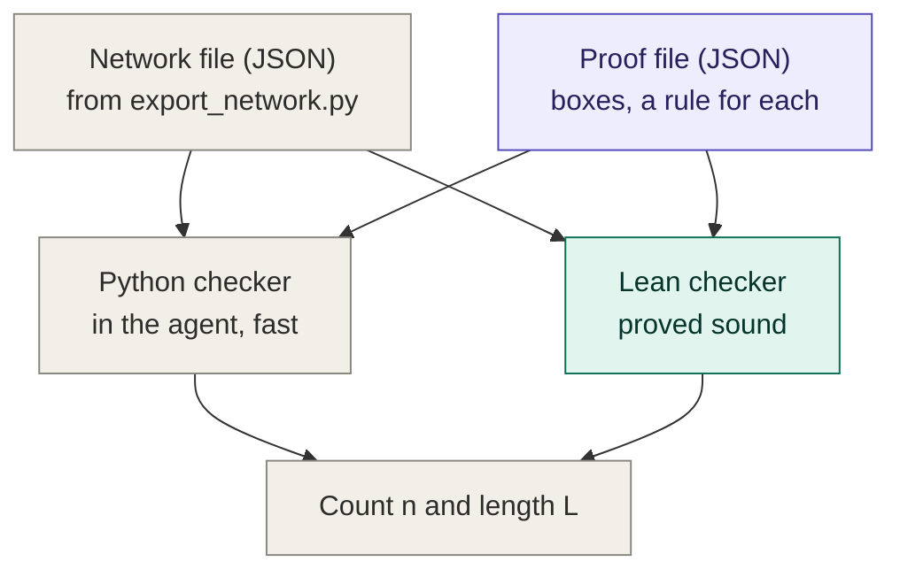
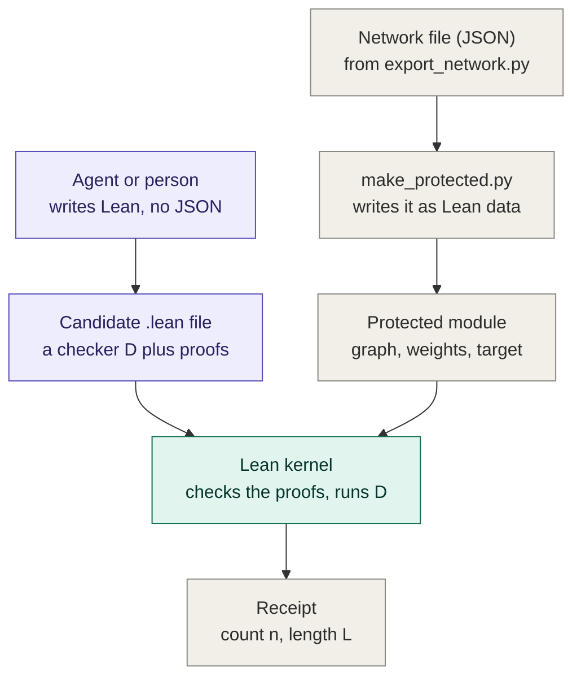

# Compact-Proof-Checker

This repo checks compact proofs about small neural networks. A compact proof shows that a trained network
gets at least n of its inputs right, with less work than running the network on every input. You give it a
network and a proof, and it tells you whether the proof is correct, how many inputs it certifies and how
long it is.

A tiny example. Take a network that reads two tokens, each 0 or 1, and should output the larger one. Brute
force runs it on all four inputs: 12 arithmetic operations. A smarter proof notices that only the
difference between the two output scores matters, and checks two inequalities instead: 6 operations. Both
prove the same thing; the second one is more compact. On bigger networks the gap grows with the number of
inputs. Short proofs usually come from understanding how the network computes, which is why we care about
them.

The Lean library inside is called CompactCheck, and its command-line program `compactcheck`.

## What it works for

A network is data here, not code: a list of operations plus its exact weights, exported from PyTorch by
`scripts/export_network.py`. Any network built from these operations works, at any size:

- linear layers, sums and additions
- matrix products, and entrywise addition, subtraction, multiplication and negation
- indexing and reshaping (index, transpose, unsqueeze, expand, cat, stack)
- `exp` and `softmax`

That covers linear models and attention-only transformers, and our xorformer. MLPs with ReLU or GELU, and
LayerNorm, are not in yet. Inputs are short token sequences over a small vocabulary, and the tasks are max,
min and majority.

## Where Lean comes in

Everything that decides whether a proof is correct is written in Lean 4 (4.35.0-rc4, with Mathlib). What it
means for the network to answer an input correctly is defined once, in `CompactCheck/Spec.lean`: run the
network's graph in exact real arithmetic, with the real exponential, and check that the right answer gets
strictly the highest score. `numCorrect` counts the inputs where this holds. Nobody computes it; proofs show
lower bounds on it.

Every verdict of this repo is a theorem about `numCorrect`, checked by Lean's kernel and using only Lean's
standard axioms. So you don't have to trust the code that checks proofs, only the definition and the script
that exports the network.

## Related repos

- [Compact-Proof-Library](https://github.com/WFJKK/Compact-Proof-Library): where we collect compact proofs
  written by hand, for example Gross et al.'s proofs for max-of-k. Each one is checked here.
- [Compact-Proof-Agent](https://github.com/WFJKK/Compact-Proof-Agent): our agent, which searches for compact
  proofs on its own and uses this checker to verify them. It pins the commit of this repo it expects in its
  `lean-checker.lock`.

## Two ways to hand in a proof

There are two lanes. In both, a proof proves the same kind of statement: the network answers at least n
inputs correctly, as defined in `Spec.lean`. They differ in what a proof is made of. In the diagrams, purple
is written by whoever hands in the proof (our agent or a person), green is checked in Lean, and grey is fixed
code and data.

### The rules lane

A proof is a JSON file: a plan that splits the inputs into boxes and names a rule for each box. `single` runs
the network exactly on one input, `interval` bounds its outputs over a whole box at once, `token_interval`
does the same while keeping each token's contribution apart, and `skip` gives up on a box. Linear networks
also have `contract`, `symmetry` and `approximate`. The rules are fixed: each one is implemented in Lean and
proved correct once (`checkProofFile_sound`), so a proof file only chooses which rule goes where.

The agent writes proof files with Python recipes. Its Python checker reads them during a run and gives the
numbers fast; the Lean checker (`compactcheck`) reads the same files and gives the same numbers with a theorem behind them. If
the two ever disagree, believe Lean. (The agent's code still calls this the legacy lane.) All the rules in
detail: [docs/RULES.md](docs/RULES.md).

### The open lane

A proof is Lean code. Whoever writes it brings their own checker for their own argument: a small program D
that takes the weights and returns how many inputs it can vouch for, together with two theorems. The first
says that for any weights, the number D returns is at most the number of inputs the network gets right. The
second says that on this network's weights, D returns n; the kernel actually runs D to check it. Together they
prove the statement. This lane is for arguments the rules can't express.

The statement itself comes from the service, not from the proof. `scripts/accept.py` writes a protected module
with the network's graph, its exact weights and the target `claimedCount ≤ numCorrect graph weights task`, and
the kernel has to accept the submitted proof (we call a submission a candidate) of exactly that. The candidate
is compiled in a sandbox, and every definition and theorem in it is re-checked by the kernel from scratch.

To get a length as well as a count, D has to be written in a small counted language
(`CompactCheck/CountedOps.lean`). Every operation on a number of the network goes through an interpreter that
charges for it, and D can't branch on what it learns, so the bill is the whole cost of the check. Details:
[docs/OPEN_LANE.md](docs/OPEN_LANE.md) and [docs/COUNTED.md](docs/COUNTED.md).

| | Rules lane | Open lane |
| --- | --- | --- |
| A proof is | a JSON plan: boxes and a rule for each | Lean code: a checker D plus proofs |
| The reasoning comes from | rules written and proved once, here | whoever writes the proof |
| Checked by | the Lean checker (and the agent's Python checker) | the Lean kernel |
| Can express | what the rules allow | any argument you can prove in Lean |

## What the numbers mean

- **Count**: how many inputs the proof certifies. It is always a lower bound on `numCorrect`. In the rules lane
  the checker adds up the sizes of the boxes whose rule succeeds. In the open lane it is the claim in the
  target, which the proof has to establish.
- **Length**: how much work checking the proof costs, in the units of our cost model (cost-v3): roughly one per
  arithmetic operation, plus one per weight read and one per number the proof hands over. In the rules lane
  Lean computes it with the same formulas as the agent's Python checker (for linear networks so far; on
  attention networks the charge of each rule is compared with Python's in tests). In the open lane it is the
  bill of D on the real weights, plus the number of weights, plus the numbers in the certificate, and the
  kernel confirms the bill.

For example, brute force on the tiny max-of-2 network (2 positions, 8 tokens, 64 inputs) runs the network 64
times at 63 operations each and reads 80 weights: count 64, length 4,112.

## What has to be trusted

- `CompactCheck/Spec.lean` and the files it rests on (`Eval.lean`, `Semantics.lean`, `Network.lean`, and the
  input spaces and labels in `Task.lean`): they say what correct means.
- `scripts/export_network.py`, which writes down the network PyTorch traces, with its exact weights.
  `scripts/compare_floats.py` checks Lean's semantics against PyTorch on every development network.
- For the open lane, also `scripts/make_protected.py` with the check of its output, `AcceptMain.lean`, and
  `scripts/accept.py` with its sandbox.
- The Lean toolchain.

The checkers themselves need no trust: the theorems are about them.

## Build and use

    lake build                  # library, proofs and tests
    lake build compactcheck     # the command-line program
    lake build acceptcheck      # the open lane's service

    # export a network of the agent's zoo
    python3 scripts/export_network.py <agent repo> models/max2 max2-v64-s0 max2-v64-s0.json

    # check a proof file; the last line is {"certified": n}
    .lake/build/bin/compactcheck max2-v64-s0.json proof.json

    # submit an open-lane candidate (a folder with manifest.json and Candidate/*.lean)
    python3 scripts/accept.py submit <candidate> --repo <agent repo> --work <work dir>

    # tests of the service (the agent repo next to this one, or COMPACT_PROOF_REPO)
    python3 -m pytest scripts/test_accept.py

The scripts need the agent's Python environment (numpy, torch). More commands are in
[docs/RULES.md](docs/RULES.md).

## What's where

| Path | What it is |
| --- | --- |
| `CompactCheck/` | the Lean library: the spec, both checkers and their proofs, the counted language |
| `AcceptMain.lean` | `acceptcheck`, the open lane's trusted check |
| `Main.lean` | `compactcheck`, the command-line program |
| `scripts/` | the exporter, the open-lane service, comparisons with Python, tests |
| `accept/` | the allowlists of the counted language |
| `examples/open_lane/` | open-lane candidates, from brute force to the agent's proofs |
| `docs/` | the details: [RULES.md](docs/RULES.md), [OPEN_LANE.md](docs/OPEN_LANE.md), [COUNTED.md](docs/COUNTED.md) |
